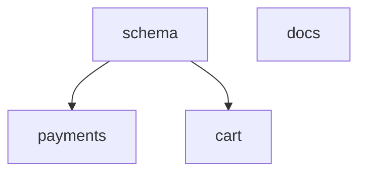

# Plan layout

> Self-describing: fold future learnings into this file directly — never into Claude memory (memory does not transfer between machines). Keep it generic, concise, well-structured.

The files of a ralph plan, their formats and who may write each. Read by every agent that touches a plan.

## Contents

- Plan directory
- Unversioned and versioned plans
- PROGRESS.md
- blocks/<name>.md
- Write ownership
- Log
- Other shapes

## Plan directory

```
<plan dir>/
  PRD.md            spec: target state only
  PROGRESS.md       index: settings, repos, blocks, worktrees, dependency diagram, plan-wide rules
  blocks/<name>.md  one block: scope, rules, task checklist, Log
```

- Always this shape. A plan that needs no split is one block.
- `{plan}` is the plan directory's name. `{block}` is the block file's stem. Both are kebab-case, since they form branch names.
- A **block** is one ralph loop: a task checklist implemented one task at a time in its own worktrees. Blocks form a DAG and unordered blocks run in parallel.

## Unversioned and versioned plans

A plan is **versioned** when `git -C <plan dir> rev-parse --is-inside-work-tree` succeeds.

- **Unversioned**: `~/.claude/ralph/{plan}/`, the default, for smaller straightforward work. Nothing there is committed, and refinement keeps no checkpoints.
- **Versioned**: any directory inside a git work tree, when the user names one, such as `<repo>/ralph/{plan}/`. Refinement commits its plan edits by path, and the main session commits plan files by path when a block finishes.
- A one-block, one-repo plan may sit inside that block's worktree; its plan files then ride each task's commit. Any other plan must sit outside every block worktree: another block's ticks would dirty that tree and read as an interrupted task.

## PROGRESS.md

````markdown
---
land: combined      # combined: each repo's blocks merge into one {plan} branch | split: every block branch is a deliverable
blocking: false     # true: a block starts only when the deliverables it depends on are merged into base
parallel: 0         # max concurrent blocks; 0 = no cap, 1 = sequential
review: high        # effort of the per-task code-review
final-review: true  # review-flow over each deliverable
mr: true            # push each deliverable and open a draft MR/PR
---
# Checkout

## Repos
| repo | path | base | branch | worktree | check |
|---|---|---|---|---|---|
| api | ~/code/api | main | checkout | ~/worktrees/api/checkout | `uv run pytest` |
| web | ~/code/web | master | checkout | ~/worktrees/web/checkout | `npm test` |

## Blocks
| block | status | summary |
|---|---|---|
| schema | done | Order tables and migration |
| payments | running | Payment provider client and webhook |
| cart | todo | Cart endpoints and the cart page |
| docs | todo | API reference |

## Worktrees
| block | repo | branch | worktree |
|---|---|---|---|
| schema | api | checkout-schema | ~/worktrees/api/checkout-schema |
| payments | api | checkout-payments | ~/worktrees/api/checkout-payments |
| cart | api | checkout-cart | ~/worktrees/api/checkout-cart |
| cart | web | checkout-cart | ~/worktrees/web/checkout-cart |
| docs | api | checkout-docs | ~/worktrees/api/checkout-docs |

## Dependencies


## Rules
- <a fact every block needs, stated once>
````

- **Frontmatter**: the only home of a plan's settings. Every key is optional and defaults to the value shown. `references/blocks.md` defines `land` and `blocking`.
- **Repos**: one row per repository the plan changes. `repo` is the short name that blocks and task paths use. `base` is the branch deliverables merge into, and differs per repo. `branch` and `worktree` are the combined `{plan}` branch and its worktree; leave both empty under `land: split`. `check` is the command that runs the repo's whole test suite from a worktree's root; a run executes it on every tip that blocks fork from or that is published. An empty cell or absent column means the repo has no check.
- **Blocks**: one row per block, in no required order. `status` is one of:
  - `todo`: not started.
  - `running`: a block workflow owns it. With no live workflow it is an interrupted block, and rerunning resumes it.
  - `done`: no unticked box remains and its work is committed.
  - `merged`: every deliverable holding its work is merged into `base`.
- **Worktrees**: one row per block per repo it changes, written before the run; the worktrees themselves are created on demand.
  - Branch is `{plan}-{block}`.
  - Worktree is `~/worktrees/<repo path below ~/code>/<branch>`, or `~/worktrees/<repo directory name>/<branch>` for a repo outside `~/code`.
  - A one-block plan under `land: combined` works directly on the `{plan}` branch, so its row repeats the Repos row.
- **Dependencies**: the only statement of block order. Every block is a node, isolated ones included. `a --> b` means b needs a's output. No cycles.
- **Rules**: optional. They bind every task of every block.

## blocks/<name>.md

```markdown
# cart
Implements: PRD §Cart API, §Cart page

## Rules
- <a fact several tasks of this block need, stated once>

## Tasks
- [ ] **T1 — cart endpoints**
  - Files: `api:src/cart/routes.py`, `api:tests/test_cart_routes.py`
  - Spec: <behavior, pinned signatures>
  - Reuse: `api:src/db/session.py::get_session`
  - Proof: `api: uv run pytest tests/test_cart_routes.py`

## Log
### 2026-01-15 — T1
- <carry-forward fact>
```

- `Implements:` names the PRD sections the block builds. Every in-scope PRD item belongs to exactly one block.
- `## Rules` is optional and binds every task in the block.
- `## Tasks` is in priority order, highest at the top; tasks run one at a time. `references/tasks.md` defines what a task pins and how large it is.
- Task ids (`T1`, `T2`, …) are local to the block file. Nothing outside the file cites one.
- A path or proof carries a `repo:` prefix when the block changes more than one repo, and none otherwise. A path is relative to the repo root, and a proof runs from the root of that repo's worktree.
- A ticked task is done and committed: never edit, merge or split it. Later tasks build on its code.
- A block is complete when no unticked box remains. There is no completion marker.

## Write ownership

Each file has one writer at a time, so nothing in a plan directory is ever merged.

| File | Writer |
|---|---|
| `PRD.md` | the user and the main session; `refine plan` while it runs |
| `PROGRESS.md` | the main session; the cut agent of `refine progress` while it runs |
| `blocks/<name>.md` | the block's own workflow agents while one runs on it; otherwise the main session |
| a block's worktrees | the block's run agents |

- A run agent writes only its block file and its block's worktrees. When what it built diverges from the PRD, it records that in the block's Log; the main session folds it into `PRD.md` when the block finishes.
- `status` is written only by the main session.
- The PRD never cites a task id, so renumbering a block never touches it.

## Log

Append a Log entry **only when the task surfaced something a future agent needs and can't recover from `git log --stat <commit>` or the code itself**. If there's nothing of that kind, skip the entry. Entries go in chronological order, newest at the bottom, under the block file's `## Log`:

```
### YYYY-MM-DD — T<n>
- One bullet per non-obvious carry-forward fact. No prose, no preamble.
```

Skip:

- "Implemented T3" or what was built: the checkbox and commit message cover it.
- File-by-file changelogs: `git log -1 --stat` is authoritative.
- Standard tooling behaviour (uv resolves workspaces, ruff reformats, pytest collects, etc.).
- Restating the PRD or the task description.

Keep:

- Library/API gotchas a future agent would re-derive the hard way (e.g. `model_validator(mode="before")` mutates the dict before `frozen=True` takes effect).
- Cross-task constraints surfaced mid-implementation (e.g. "T7 must repoint the notebooks importing `stats.utils.plot` to `plotting.*`").
- Decisions that diverge from the PRD or override its mapping table. State what was built instead, so the main session can fold it into the PRD.

## Other shapes

- **Pre-block plan**: a `PROGRESS.md` holding a task checklist, with no `blocks/` beside it. Convert it before any other work: move the checklist, its shared rules and its Log into `blocks/{plan}.md` in the format above, then write `PROGRESS.md` as a one-block index. Ticked tasks stay ticked.
- **Single-file plan**: one file under `~/.claude/plans/` holding spec and checklist together. It is a valid target for `/ralph review`, `/ralph compact` and the review skills, judged against `references/prd.md` and `references/tasks.md`. The block conventions do not apply to it, and `/ralph run` does not run it.
